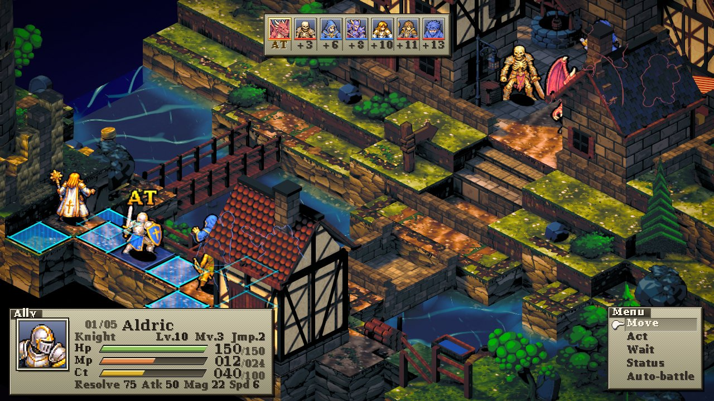
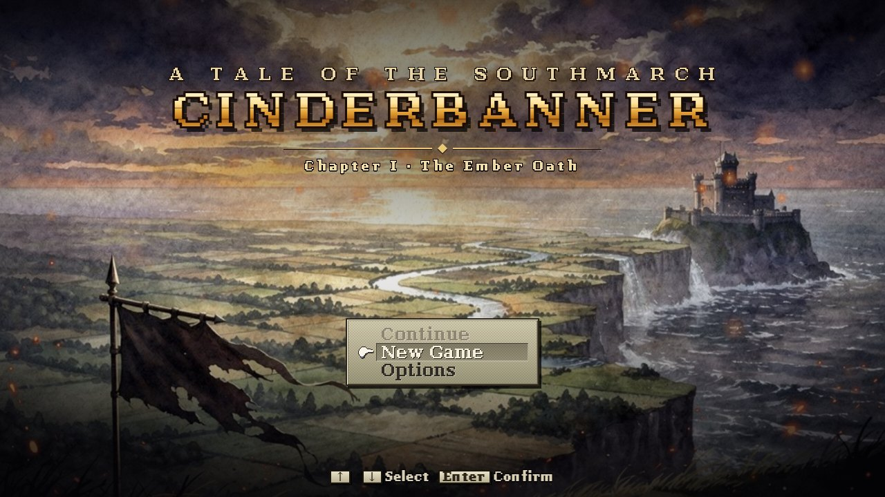

# Cinderbanner

An isometric, turn-based tactical RPG that runs in the browser: Three.js dioramas, charge-time battles,
a job system, and a two-chapter campaign. No game engine, and every sound is synthesised at runtime.



<p align="center"></p>

**Play it:** https://brepre109.github.io/cinderbanner/ (once GitHub Pages is enabled; see *Deploying* below).

## Features

- **Charge-time battles.** Every unit fills a CT gauge at its own speed and acts at 100. Moving, acting or
  waiting sets how much of the gauge it keeps, and spells take time to charge, so you can see a big cast
  coming and step out of it. Height, facing and terrain all affect the outcome.
- **47 classes and 206 abilities.** 31 human jobs (Knight, Cleric, Sorcerer, Chronomancer, Wyrmlancer,
  Earthshaper, Runesword, Bellwarden and more) plus 16 monster types. Each unit has an action set, a
  secondary set, and reaction, support and movement abilities. Job levels are bought with JP earned in battle.
- **Campaign.** Two chapters (*The Ember Oath* and *The Hollow Crown*) with painted world maps, 20 story and
  side battles, towns with shops and recruits, formation and equipment screens, boss set pieces, scripted
  scenes played out on the battle map, and Story/Normal/Hard difficulty. Progress is saved in `localStorage`.
- **21 hand-built maps** plus a procedural generator. Each map is a diorama with terraces, rivers, bridges,
  interiors and a roof cutaway that opens when units walk under cover.
- **Rewind.** The engine is seeded and can snapshot its whole state, so you can press `R` to undo back to
  any earlier turn and pick a different move.
- **Spell cinematics and summons.** Particle and shader effects, full-screen set pieces for the biggest
  spells, and procedurally painted pixel-art summon creatures.
- **Procedural score.** A WebAudio orchestra synthesiser (strings, brass, harp, choir, bells, organ) plays
  original themes composed in code, plus all the UI and combat sound effects.
- **Map Builder** (`editor.html`). Paint heights and surfaces, place props and spawns, check routes and
  reachability for every roster tier, then play-test the map right away.
- **Headless tooling.** A balance simulator that runs AI-vs-AI battles and the whole campaign in Node, a
  rewind determinism test, a map linter with 23 checks, and a headless Chrome capture rig.

## Quick start

Requires Node 20+ and a browser with WebGL 2.

```bash
npm ci
npm run dev          # http://127.0.0.1:5190/
```

- `/`: campaign (title, then world map, story, formation and battle)
- `/?battle=1&map=wendford_crossing`: jump straight into a skirmish (`&mode=ai` makes both sides AI-driven)
- `/editor.html`: the Map Builder

Other scripts:

```bash
npm test             # map linter + rewind determinism test + a short seeded balance sim
npm run build        # static site in dist/ (relative base, so it works from any sub-path)
npm run preview      # serve dist/ locally
npm run sim -- n=200 roster=all     # AI-vs-AI balance run with per-class win rates
node src/game/campaignsim.mjs n=64  # plays the whole campaign headless, battle by battle
npm run shot -- shots/demo presets=wide,mid scenario=menu   # headless Chrome capture (needs google-chrome)
```

### Controls

Keyboard first, and every key can be rebound in Options. Arrows/WASD move the cursor. Enter/Space/Z
confirms, Esc/X cancels. `Q`/`E` rotate the camera, `T` tilts it, `+`/`-` zoom. `Tab` cycles targets.
`V` toggles the threat map, `R` opens Rewind, `F` changes battle speed (hold Shift to fast-forward),
`H` shows the controls and `P` pauses. Some screens also take mouse clicks.

## Architecture

```
src/main.js            router: bare URL -> campaign shell, ?battle=1 / ?map= -> battle page
src/campaign/          title, world map, story, formation, shop, results, save (DOM only, no three.js)
src/core/battleboot.js the battle page: scene, camera, pipeline, UI and the turn loop
src/game/              rules, AI, classes/abilities data, progression, equipment (pure JS, runs in Node)
src/world/             map format, compiler, validator, terrain, batched props, procedural generator
src/render/            camera rig, lighting, post-processing, cinematics, roof cutaway
src/units/  src/vfx/   sprite-sheet units and animation; spell effects, summons, particles
src/audio/             procedural WebAudio synthesiser and the score
src/editor/            the Map Builder
tools/                 mapcheck (headless map linter), shot/smoke capture rig, sprite/texture packers
```

- **Game logic has no DOM or three.js.** `src/game` holds the rules, AI and data, and the same modules drive
  the browser game, `sim.mjs`, `campaignsim.mjs` and `rewindtest.mjs`. The engine RNG is seeded, which is
  what makes rewind, the tests and balance runs reproducible.
- **Event bus.** Rendering, VFX, camera and audio subscribe to `battle.on('turnStart' | 'moveStart' |
  'abilityStart' | 'impact' | 'damage' | 'ko' | 'victory', fn)` and never touch the turn logic.
- **Campaign battles are full page loads.** Party, results and progress go through a versioned
  `localStorage` save (`src/campaign/save.js`).
- **Maps are data.** A map is an ES module that exports a `MapDef` (heights, surfaces, props, spawns, routes).
  `mapformat/compile.js` turns it into the runtime grid, `tools/mapcheck.mjs` lints the whole set, and the
  editor writes the same format.
- **Performance.** Static props are merged into batches and the shadow map is cached. There is adaptive
  resolution and a capped device-pixel ratio, and resize handling was leak-tested for 20 minutes.
- `DESIGN.md` is the original vertical-slice design document (turn order, stats, class sheet, balance rules).
  Code comments refer to it as `DESIGN §n`.

## Tech stack

JavaScript (ES modules), [Three.js](https://threejs.org/) r180, [Vite](https://vitejs.dev/) 6, WebAudio,
Node for the headless sims and linters, and puppeteer-core with headless Chrome for captures. The asset
pipeline scripts are Python (Pillow, NumPy, fontTools).

## Art and assets

- Unit sprite sheets, portraits, environment sprites, terrain textures and the painted title and world-map
  images are **AI-generated for this project** and then keyed, packed and colour-conditioned by
  `tools/pack_sprites.py`, `tools/pack_portraits.py` and `tools/build_textures.py`. The raw generated
  source frames are not in this repo, so those packers are included for reference only. The location
  stills in `src/campaign/stage/maps/` are renders of the game's own maps.
- Music and sound effects are synthesised in code. The repo contains no audio files.
- The UI font (`public/fonts/cinder-*.ttf`) is a bitmap-style derivative of DejaVu Serif Bold, distributed
  under the Bitstream Vera licence (`public/fonts/LICENSE-FONTS.txt`).

## Deploying (GitHub Pages)

`.github/workflows/pages.yml` runs the tests, builds, and deploys `dist/` with `actions/deploy-pages` on
every push to `main`. To turn it on, set **Settings → Pages → Source → GitHub Actions**. The Vite base is
relative (`./`) and runtime asset URLs are relative, so the build works at `/<repo>/` without further
configuration.

## Status / limitations

- This is a playable prototype, not a finished game. The campaign has two chapters, balance was tuned
  with the headless sims plus hand play, and writing and pacing are still rough in places.
- It needs a real GPU for smooth play. It does run on software WebGL (SwiftShader), which is how the capture
  rig works, but slowly. It is built for desktop and keyboard; there is no touch support.
- Code comments are detailed and often mention the measurement or review round behind a change (for
  example `R17`). The game was built over many short iterations with AI coding agents, with headless
  captures and sims checking every round.
- Saves live in the browser's `localStorage`, and there is no cloud sync.

## License

MIT for the code, © 2026 Brett Prejeant (see `LICENSE`). The bundled font keeps its own licence (see above).
